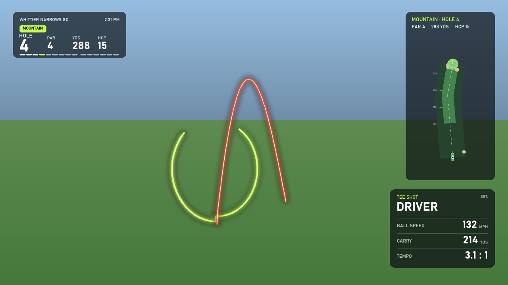

# ⛳ golf-course-vlog-skill

**一场球的原片丢进来，一条带转播 UI 的整场 vlog 走出去。**
A Claude Code skill that turns a folder of raw golf-round footage into a full-course vlog with a broadcast-style overlay.



## 它做什么 · What it does

我打完一场球，拍了 70 多段、两个多小时的素材。这个 skill 把剪辑全流程交给 Claude：

- **找挥杆**：YOLO pose 识别上杆、击球、收杆，再加击球声检测，分出真挥杆和空挥；按裤子颜色区分是我还是球友。
- **标球洞**：从 OpenStreetMap 画出每洞地图，配上记分卡里的 par、码数和难度。左上角常驻 HUD，显示当前第几洞和全场进度。
- **画挥杆**：60fps 手部轨迹逐帧生长；4K 帧差追踪真实球路，追不到的画透视示意弧线；数据卡显示杆型、球速、飞行距离和节奏比，都标了「EST.」。
- **留对话**：Whisper 转写全部对话，挑出有梗的片段配字幕。
- **衍生剪辑**：满意球精华（按收杆停留时长挑）、球友全部出杆、下杆快剪，以及配你自己的歌、按底鼓逐拍对齐的卡点视频。

After a round I had 70+ clips and two hours of footage. This skill hands the whole edit to Claude:

- **Swing detection**: YOLO pose finds each swing's top, impact and finish, and impact-sound detection separates real shots from practice swings. Players are told apart by pants color.
- **Hole info**: hole maps come from OpenStreetMap and par, yardage and handicap from the scorecard. A persistent HUD shows the current hole and round progress.
- **Swing overlays**: a 60fps hand-path tracer, plus ball flight tracked from 4K frame differences. Shots it can't track get a perspective arc labelled as predicted. Shot cards show club, ball speed, carry and tempo, all labelled as estimates.
- **Dialogue**: Whisper transcribes the whole round, and the best exchanges get subtitles.
- **Spin-off cuts**: a best-shots reel (picked by how long the finish was held), the playing partner's full reel, a downswing speed-cut, and a cut synced to the kick drum of your own song.

The pipeline is "detect → human review → EDL → render". The machine finds everything, and a person only checks what it isn't sure about. One JSON edit list drives every cut and overlay, so a fix means editing one entry and re-rendering.

## 安装 · Install

```bash
git clone https://github.com/ezshrimps/golf-course-vlog-skill ~/.claude/skills/golf-course-vlog
pip install -r ~/.claude/skills/golf-course-vlog/requirements.txt
```

Then tell Claude Code something like「把 D:\Videos\今天打球 剪成整场 vlog」, or "make a full course vlog from this folder".

**Requirements**:
- Windows with an NVIDIA GPU (NVENC, CUDA).
- `ffmpeg` on your PATH.
- 4K 59.94fps footage with DJI-style file names (`DJI_<timestamp>_<NNNN>_*.MP4`). LRF proxies are optional.

## 结构 · Layout

| | |
|---|---|
| `SKILL.md` | 给 Claude 的完整流程：每一步的命令、人工核对点和踩过的坑 · The full playbook Claude follows |
| `scripts/` | 32 个 Python 脚本：检测、分析、EDL、UI、渲染、卡点 · Detection, analysis, EDL, UI, render, beat-sync |
| `templates/` | `project.json`（素材位置、记分卡、分洞）和 `edl_cfg.json` 示例，以 Whittier Narrows 为例 · Example configs |

## 说明 · Notes

- 球速、飞行距离和杆型都是**根据画面估算**的，不是测距仪数据。Ball speed, carry and club are **estimates from video**, not launch-monitor data.
- 球洞地图数据 © OpenStreetMap contributors (ODbL)。
- 配乐请用你有权使用的音频，这个 skill 不会替你下载歌曲。Use music you have the rights to.

MIT License
